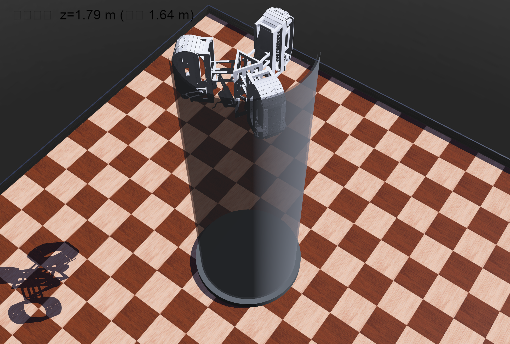

# 三足履带爬管机器人仿真 · Tracked Pipe-Climbing Robot in Webots

[](https://cyberbotics.com)
[](https://www.python.org)
[](LICENSE)

一台三条履带腿的机器人，像奔驰车标的三叉一样 120° 均匀撑住竖直钢管的内壁，
靠履带贴着管壁从管底一路爬到管顶。本仓库是一套完整、开箱即用的 [Webots](https://cyberbotics.com) 仿真，不依赖仓库以外的任何文件。



## 机器人是怎么爬的

1. **张腿（开机 0～3 秒）**：三条腿慢慢张开，履带外表面贴住管内壁，俯视正好是奔驰车标的三叉；
2. **爬升（3 秒之后）**：机体沿管轴以 5 cm/s 匀速上升，132 块履带板沿各自履带环循环滚动——贴壁侧向下、回程侧向上，和真实履带的运转一致；
3. **到顶（约 37 秒）**：爬完 1.64 米到管顶停住，程序自动核对关节角度和最终高度并写入日志。

每条腿内部是一个平行四边形机构：只动主关节时，履带面保持竖直平移、不发生倾斜，
因此三条腿能撑到同一个半径、互差 120°，恰好贴合管内壁。
爬升由 Webots 的 Supervisor 节点（导演视角）驱动，不依赖摩擦力仿真，
所以每次运行结果完全一致，适合展示和录像。

## 仓库结构

```
├── README.md                        本说明
├── LICENSE                          MIT 开源许可证
├── worlds/
│   └── pipe_climb.wbt               仿真世界（场景 + 机器人），用 Webots 打开的就是它
├── controllers/
│   └── pipe_climber/                机器人的"大脑"（Python 程序）
│       ├── pipe_climber.py          主程序：张腿 → 爬升 → 到顶自查
│       └── gait_data.py             动作数据：关节角度表、履带环参数（想调速改这里）
├── meshes/                          机器人的三维外壳（16 个 STL 模型文件，请勿移动）
└── docs/
    └── demo.png                     运行效果截图
```

## 快速开始

**环境要求**

- [Webots](https://cyberbotics.com) 2023b 及以上（本项目在 R2025a 上制作）
- Python 3（安装时务必勾选 **"Add Python to PATH"**，否则 Webots 找不到它）

**运行步骤**

```text
1. 打开 Webots
2. 菜单 File → Open World... 选择本仓库的 worlds/pipe_climb.wbt
3. 首次打开需联网下载官方背景和地板素材（之后有缓存，离线可用）
4. 点工具栏 ▶（播放）开始仿真
5. 想再看一遍：点 ⟲（Reset）回到初始状态，再点 ▶
```

不需要编译、不需要 Build，打开就能跑。

运行过程记录在 `controllers/pipe_climber/controller_log.txt`，
到顶时还会在仓库根目录存一张截图 `climb_final.png`。

## 调节参数

用记事本打开 `controllers/pipe_climber/gait_data.py`：

| 参数 | 含义 | 默认值 |
|---|---|---|
| `CLIMB_VEL` | 爬升速度（米/秒），改成 `0.1` 即两倍速 | `0.05` |
| `Z_START` / `Z_END` | 起爬和到顶的高度（米） | `0.15` / `1.79` |
| `T_INIT`（在 pipe_climber.py 中） | 张腿动作时长（秒） | `3.0` |

改完保存，回 Webots 点 Reset 再 ▶ 即可生效。

## 常见问题

| 现象 | 原因与解决 |
|---|---|
| 机器人不动 / 控制台报 python 错误 | Python 没装好或没加入 PATH。重装并勾选 "Add Python to PATH"，重启 Webots |
| 背景或地板显示成纯色 / 报 proto 下载失败 | 首次打开需联网。联网打开一次后素材会缓存，之后离线可用 |
| 机器人显示不全（缺胳膊少腿） | `meshes/` 里的 16 个 STL 缺失或被移动了，请保持仓库结构原样 |
| 画面全黑 | 世界文件损坏或 STL 缺失，重新 clone 一份完整仓库即可 |

## 许可证

本项目以 [MIT License](LICENSE) 开源，模型文件与代码可自由使用、修改和再分发，请注明出处。
